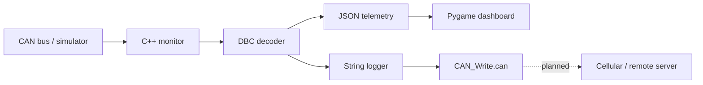

<div align="center">

# Formula SAE EV Telemetry Dashboard

**CAN decoding, simulation, and telemetry display software for a Formula SAE electric vehicle**

[](https://en.cppreference.com/w/cpp/17)
[](https://cmake.org/)
[](https://www.python.org/)
[](https://www.pygame.org/)

</div>

---

## Overview

This repository contains the software stack for decoding, simulating, and displaying CAN telemetry for the CU Boulder Formula SAE EV project.

The project currently uses two CAN networks:

| Network   | Database             | Main data                        |
| :-------- | :------------------- | :------------------------------- |
| **CAN 1** | `can1_inverters.dbc` | Four inverter / powertrain nodes |
| **CAN 2** | `can2_pdu.dbc`       | PDU current and channel status   |

The same software path can be tested without vehicle hardware using **demo mode**, or connected to real CAN hardware through **Linux SocketCAN**.

### Data flow



---

## Features

- DBC-based CAN message and signal decoding
- Standard and extended CAN identifiers
- Human-readable or JSON monitor output
- DBC-driven CAN traffic simulation
- In-process virtual CAN for hardware-free demo mode
- Linux SocketCAN support
- Dual-bus dashboard using two DBC files
- Four-inverter telemetry: FL / FR / RL / RR
- PDU current and fault monitoring
- CAN timeout and temperature warning indicators
- Speed calculation from ERPM, gearing, and wheel diameter
- 800 × 480 fullscreen dashboard support
- Pipe-delimited telemetry log written through FatFS (`Cellular/`)

---

## Project Structure

```text
Telemetry-Dash-Firmware/
│
├── CMakeLists.txt          # Root CMake file
├── .gitignore
├── requirements.txt        # Python dependencies for the dashboard
│
├── CAN_disect/
│   ├── CAN_Tools/          # C++ CAN + DBC tools
│   │   ├── Monitor.cpp
│   │   ├── Simulator.cpp / Simulator.h
│   │   ├── can_bus.cpp / can_bus.h
│   │   ├── dbc_parser.cpp / dbc_parser.h
│   │   ├── dbc_scan.cpp / dbc_scan.h
│   │   ├── dbc_val_parser.cpp / dbc_val_parser.h
│   │   ├── msg_hash_table.cpp / msg_hash_table.h
│   │   ├── simulator_main.cpp
│   │   └── CMakeLists.txt
│   │
│   ├── Cellular/           # Telemetry string logger (see Cellular/README.md)
│   │   ├── String_Write.cpp / String_Write.h
│   │   ├── fatfs/          # ChaN FatFs R0.16
│   │   ├── text_files/     # Sample CAN lines and generated CAN_Write.can
│   │   └── test/           # Host-side test + fake FatFS (test/mock/ff.h)
│   │
│   ├── DBC/                # CAN database files
│   │   ├── can1_inverters.dbc
│   │   ├── can2_pdu.dbc
│   │   └── haltech_ecu.dbc
│   │
│   └── py_test_files/      # Standalone Python CAN utilities
│       ├── Monitor.py
│       └── Simulator.py
│
└── Dash/
    └── dashboard_mac.py    # Pygame telemetry dashboard
```

---

## Requirements

### C++ tools

- CMake 3.10+
- C++17-compatible compiler
- POSIX threads
- Linux for real SocketCAN operation

### Python dashboard

- Python 3
- `pygame`

Create a virtual environment and install the dependencies:

```bash
python3 -m venv .venv
source .venv/bin/activate
python -m pip install -r requirements.txt
```

For the standalone Python CAN utilities:

```bash
python3 -m pip install pygame python-can cantools
```

> `.venv/` and `build/` are git-ignored. Rebuild them locally after cloning.

---

## Quick Start

Demo mode is the fastest way to test the complete pipeline. **No CAN hardware is required.**

### 1. Build the C++ tools

From the repository root:

```bash
cd CAN_disect/CAN_Tools
cmake -S . -B build
cmake --build build -j2
```

Build outputs:

```text
build/monitor
build/simulator
```

### 2. Test the monitor

Run simulated inverter traffic:

```bash
./build/monitor --dbc ../DBC/can1_inverters.dbc --demo
```

For dashboard-friendly JSON:

```bash
./build/monitor --dbc ../DBC/can1_inverters.dbc --demo --json
```

### 3. Run the dashboard

From the repository root:

```bash
cd Dash
python3 dashboard_mac.py \
  --monitor-bin ../CAN_disect/CAN_Tools/build/monitor \
  --dbc1 ../CAN_disect/DBC/can1_inverters.dbc \
  --dbc2 ../CAN_disect/DBC/can2_pdu.dbc \
  --demo
```

---

## Real CAN Operation

Real vehicle operation uses **Linux SocketCAN**.

### Full dashboard

```bash
cd Dash
python3 dashboard_mac.py \
  --monitor-bin ../CAN_disect/CAN_Tools/build/monitor \
  --dbc1 ../CAN_disect/DBC/can1_inverters.dbc \
  --dbc2 ../CAN_disect/DBC/can2_pdu.dbc \
  --socketcan \
  --channel1 can0 \
  --channel2 can1
```

### Monitor CAN 1 directly

```bash
cd CAN_disect/CAN_Tools
./build/monitor \
  --dbc ../DBC/can1_inverters.dbc \
  --socketcan \
  --channel can0
```

### Monitor CAN 2 directly

```bash
./build/monitor \
  --dbc ../DBC/can2_pdu.dbc \
  --socketcan \
  --channel can1
```

> SocketCAN interfaces must already be configured and available by the operating system.

---

## Monitor CLI

```text
monitor --dbc <file> (--demo | --socketcan --channel <if>) [--period-ms <n>] [--json]
```

| Option            | Purpose                                | Default  |
| :---------------- | :------------------------------------- | :------: |
| `--dbc <file>`    | DBC to decode                          | Required |
| `--demo`          | Use the built-in virtual CAN simulator |    —     |
| `--socketcan`     | Read from Linux SocketCAN              |    —     |
| `--channel <if>`  | CAN interface name                     |  `can0`  |
| `--period-ms <n>` | Demo simulation period                 |  `100`   |
| `--json`          | Emit one JSON object per frame         |   Off    |

Use either `--demo` **or** `--socketcan`.

---

## Dashboard CLI

```text
python3 dashboard_mac.py
```

| Option                    | Purpose                     |   Default   |
| :------------------------ | :-------------------------- | :---------: |
| `--monitor-bin <path>`    | C++ monitor executable      | `./monitor` |
| `--dbc1 <path>`           | Inverter DBC                |  Required   |
| `--dbc2 <path>`           | PDU DBC                     |  Required   |
| `--demo`                  | Start monitors in demo mode |     Off     |
| `--socketcan`             | Use live SocketCAN          |     Off     |
| `--channel1 <name>`       | CAN 1 interface             |   `can0`    |
| `--channel2 <name>`       | CAN 2 interface             |   `can1`    |
| `--fullscreen`            | Fullscreen display          |     Off     |
| `--pole-pairs <n>`        | Motor pole pairs            |     `5`     |
| `--gear-ratio <n>`        | Motor revs per wheel rev    |     `4`     |
| `--wheel-diameter-in <n>` | Tire rolling diameter       |   `18` in   |

### Fullscreen demo

```bash
python3 dashboard_mac.py \
  --monitor-bin ../CAN_disect/CAN_Tools/build/monitor \
  --dbc1 ../CAN_disect/DBC/can1_inverters.dbc \
  --dbc2 ../CAN_disect/DBC/can2_pdu.dbc \
  --demo \
  --fullscreen
```

Press **Esc** to exit fullscreen.

---

## Telemetry

### Inverters

(needs to be updated)

The dashboard tracks four inverter positions:

| ID       | Position    |
| :------- | :---------- |
| `INV_FL` | Front Left  |
| `INV_FR` | Front Right |
| `INV_RL` | Rear Left   |
| `INV_RR` | Rear Right  |

Current dashboard values include:

- ERPM
- Input voltage
- Motor temperature
- Controller temperature
- Fault code

### PDU

Eight current channels and eight channel-status signals are available:

```text
PDMMeasuredCurrent01 ... PDMMeasuredCurrent08
PDMErrorStatus01     ... PDMErrorStatus08
```

Defined PDU status values include:

| Value | Status                 |
| :---: | :--------------------- |
|  `0`  | OK                     |
|  `1`  | Open Circuit           |
|  `2`  | Current Limit Exceeded |
|  `3`  | Short Circuit          |

---

## Speed Calculation

Vehicle speed is calculated from inverter ERPM:

```text
Mechanical RPM = |ERPM| / pole pairs
Wheel RPM      = Mechanical RPM / gear ratio
Vehicle speed  = Wheel RPM × tire circumference
```

Current dashboard defaults:

| Setting          |   Value |
| :--------------- | ------: |
| Motor pole pairs |     `5` |
| Gear ratio       |   `4:1` |
| Wheel diameter   | `18 in` |

These are software defaults and should match the actual vehicle configuration before vehicle testing.

---

## JSON Telemetry Interface

The C++ monitor's `--json` mode emits **one JSON object per decoded CAN frame**. The dashboard consumes this stream as its telemetry input.

Example:

```json
{
  "ts": "2026-09-29 16:25:33.496",
  "id": 1025,
  "name": "INV_FL_General1_ERPM_Duty_Vin",
  "signals": {
    "InputVoltage": 330,
    "Duty": 34.2,
    "ERPM": 644
  }
}
```

This interface also makes it straightforward to connect the decoder to another application later.

---

## Telemetry Logging (Cellular)

The `Cellular/` module turns the monitor's human-readable output into a pipe-delimited log and writes it to `CAN_Write.can` through FatFS. This is the first step toward sending live data to a remote server.

Monitor line (fields separated by two spaces):

```text
2026-10-23 10:14:26.974  0x22  INV_FR_Cmd_SetACCurrent  ACCurrent=-87.9A
```

Logged line:

```text
2026-10-23 10:14:26.974|0x22|INV_FR_Cmd_SetACCurrent|ACCurrent|-87.9A
```

Run the host-side test (no SD card needed) from `CAN_disect/Cellular`:

```bash
g++ -g -std=c++17 -include test/mock/ff.h -I. test/test_string_write.cpp String_Write.cpp -o test_sw
./test_sw
```

See [`CAN_disect/Cellular/README.md`](CAN_disect/Cellular/README.md) for the input/output format, the mock FatFS, and known limitations.

---

## C++ Architecture

| File / module      | Responsibility                                           |
| :----------------- | :------------------------------------------------------- |
| `dbc_parser.*`     | Parse DBC message and signal definitions                 |
| `dbc_scan.*`       | Scan DBC message definitions used by the simulator       |
| `dbc_val_parser.*` | Parse `VAL_` enumerations                                |
| `msg_hash_table.*` | Fast message / signal lookup                             |
| `can_bus.*`        | SocketCAN and in-process virtual CAN abstraction         |
| `Simulator.*`      | Generate DBC-driven synthetic CAN frames                 |
| `Monitor.cpp`      | Receive, decode, and serialize CAN data                  |
| `String_Write.*`   | Parse monitor lines and append them to the log via FatFS |
| `dashboard_mac.py` | Render telemetry and status in Pygame                    |

The key software boundary is:

```text
CAN frame
   ↓
C++ DBC decoder
   ↓
JSON line
   ↓
Python dashboard
```

---

## DBC Databases

### `can1_inverters.dbc`

Inverter / powertrain CAN database. The dashboard currently consumes signals such as ERPM, input voltage, motor temperature, controller temperature, and fault code.

### `can2_pdu.dbc`

PDU CAN database containing measured current and channel error status.

### `haltech_ecu.dbc`

Additional ECU database included for future or alternate telemetry integration. It is not required by the current dashboard command.

---

## Python CAN Utilities

Standalone Python CAN tools are located in `CAN_disect/py_test_files/`.

### Monitor

```bash
python3 CAN_disect/py_test_files/Monitor.py \
  --dbc CAN_disect/DBC/can2_pdu.dbc \
  --demo
```

### Simulator

```bash
python3 CAN_disect/py_test_files/Simulator.py \
  --dbc CAN_disect/DBC/can2_pdu.dbc \
  --duration 30
```

These utilities are separate from the current C++ monitor/dashboard path and are useful for standalone CAN / DBC testing.

---

## Troubleshooting

### Dashboard opens but values do not change

Test the monitor by itself:

```bash
cd CAN_disect/CAN_Tools
./build/monitor --dbc ../DBC/can1_inverters.dbc --demo --json
```

You should see a continuous JSON stream. If that works, verify the dashboard's `--monitor-bin`, `--dbc1`, and `--dbc2` paths.

### `monitor` is missing

`build/` is not stored in git, so build it after cloning:

```bash
cd CAN_disect/CAN_Tools
cmake -S . -B build
cmake --build build -j2
```

The executable should be:

```text
CAN_disect/CAN_Tools/build/monitor
```

### `ModuleNotFoundError: No module named 'pygame'`

The virtual environment is missing or not active:

```bash
source .venv/bin/activate
python -m pip install -r requirements.txt
```

If pygame fails to install on a new Python version, try `pygame-ce` (same `import pygame`).

### SocketCAN is unavailable on macOS

Real SocketCAN operation requires Linux. Use `--demo` for local development and dashboard testing on macOS.

### Telemetry becomes stale

The dashboard uses a **500 ms CAN timeout**. Check the CAN interface, DBC, message IDs, and whether the expected frames are being transmitted.

---

## Development Workflow

```bash
# Build the C++ tools
cd CAN_disect/CAN_Tools
cmake -S . -B build
cmake --build build -j2

# Test CAN 1 / inverter decoding
./build/monitor --dbc ../DBC/can1_inverters.dbc --demo --json

# Test CAN 2 / PDU decoding
./build/monitor --dbc ../DBC/can2_pdu.dbc --demo --json

# Run the complete dashboard
cd ../../Dash
python3 dashboard_mac.py \
  --monitor-bin ../CAN_disect/CAN_Tools/build/monitor \
  --dbc1 ../CAN_disect/DBC/can1_inverters.dbc \
  --dbc2 ../CAN_disect/DBC/can2_pdu.dbc \
  --demo

# Test the telemetry string logger
cd ../CAN_disect/Cellular
g++ -g -std=c++17 -include test/mock/ff.h -I. test/test_string_write.cpp String_Write.cpp -o test_sw
./test_sw
```

---

## Current Status

**In development.**

The current software pipeline for the dash is:

```text
DBC definitions
      ↓
CAN simulation / Linux SocketCAN
      ↓
C++ DBC decoding
      ↓
JSON telemetry stream
      ↓
Pygame dashboard
```

The current goal for the dash...

- is to find everything that is needed to be displayed
- make the dash look better
- integrate it on the rasp pi
- transport the live CAN data (json) from stm to the pi, and display on the screen

The current software pipeline for the telemetry is:

```text
DBC definitions
      ↓
CAN simulation / Linux SocketCAN
      ↓
C++ DBC decoding
      ↓
format values into pipe-delimited strings (done, writes CAN_Write.can)
      ↓
send values to remote server (planned)
      ↓
access server with visualization software (planned)
```

The current goal for the telemetry...

- update the DBC so its accurate to car
- hook the live monitor output into the string logger
- write program for transporting a stream of strings via cellular
- work on live GPS location program
- set up live server
- create/find visualization software

---

## Author

**Nicholas Gowin**  
CU Boulder Formula SAE EV
